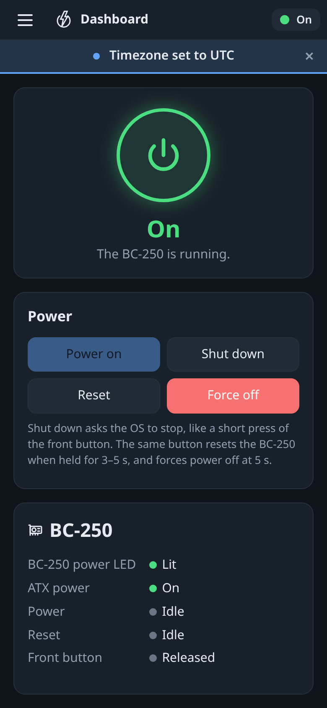
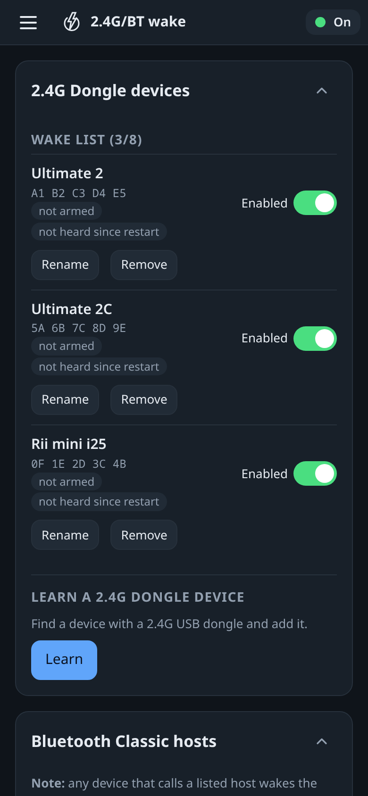
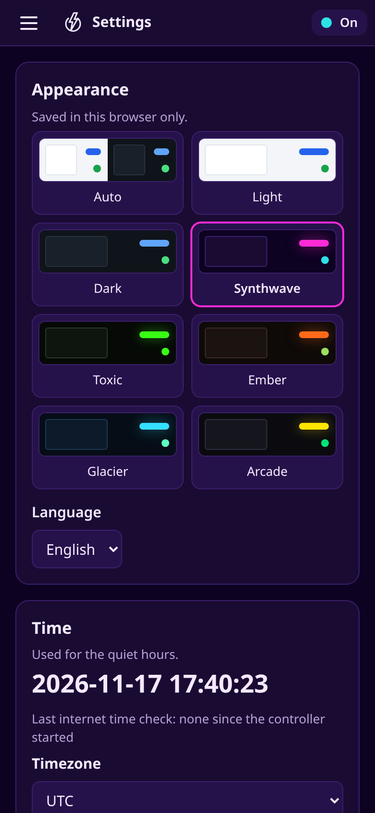
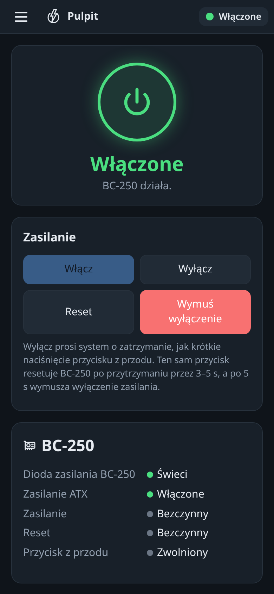
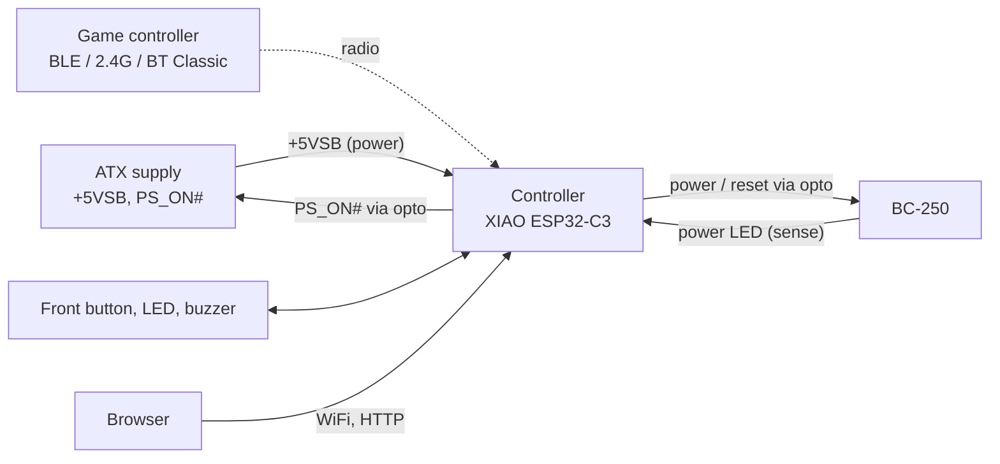
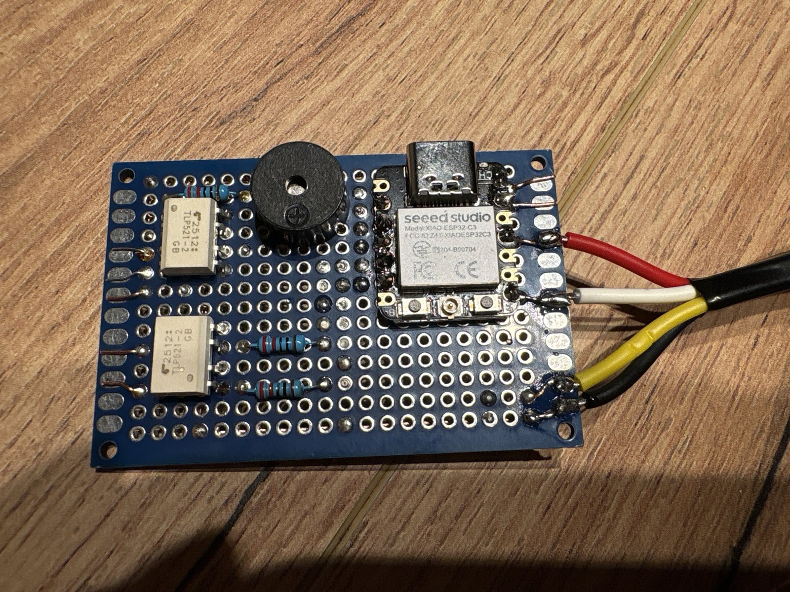
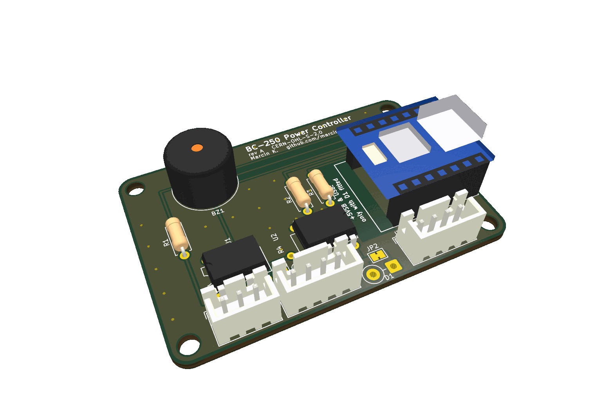

# BC-250 power controller

**Turn an AMD BC-250 PC and its ATX supply on and off like a console: front button, web UI, and wake by switching on your game controller.**

   

The AMD BC-250 is a mining board built around a cut-down PS5 APU, popular as
a cheap gaming PC. It runs from an ATX supply and has only front-panel pads
for its power and reset buttons. This project is a small controller board (a
Seeed XIAO ESP32-C3 and two dual optocouplers) between the supply and the
BC-250 that makes it behave like a console: one button, a web UI, and
power-on by switching on a game controller.

**Status:** the firmware runs on hand-built perfboard controllers. PCB rev A
is designed (ERC and DRC clean) but not yet fabricated or tested.

## Features

**Power control**
- Front button with LED and buzzer: tap to start or shut down, hold to reset,
  hold longer to cut the power. Hold times, beeps and LED are settings.
- Switches the ATX supply (PS_ON#) and presses the BC-250's power and reset
  buttons; reads its power LED to know the real state.
- Runs from +5VSB, so it is reachable whenever the supply is plugged in.

**Wake on controller**
- Switch on a game controller and the PC starts, with no extra hardware.
- Two methods, chosen on the wake page: **BLE** (any Bluetooth LE controller)
  or **2.4G/BT** (2.4G USB-dongle devices and Bluetooth Classic controllers
  such as the DualShock 4).
- Detection uses the ESP32-C3's own radio through its raw capture engine
  (see Credits). Wake lists hold up to 8 BLE devices, or 8 2.4G dongle
  devices and 2 Bluetooth Classic hosts. The re-arm time stops a controller
  that is left on from restarting the PC after shutdown.

**Web UI**
- Dashboard, power control, event log, settings, network, security, themes.
- Setup wizard on first start (`BC250-Setup` network), password, mDNS name
  `bc250.local`, fixed IP or DHCP, WiFi roaming between access points.
- Debug view with a simulated BC-250, so the whole sequence can be tried on
  the bench.

**Safety and updates**
- Update over WiFi from the browser; the previous firmware stays in the
  other slot. Restart and updates keep the PC running (PS_ON is latched
  through a deliberate restart).
- NTP clock, timezone and quiet hours for the buzzer.
- Automatic OS updates of the BC-250 at night over SSH: a silent start, the
  update, a shutdown. A failed or interrupted update ends with the BC-250
  shut down. The update script handles pacman, rpm-ostree with Flatpak,
  and dnf.
- Password-protected UI and API, recovery gesture for a forgotten password.

**Languages**
- Translatable interface with gettext-style catalogs (`docs/TRANSLATING.md`).
  English and Polish ship first; more are welcome.

## How it works

The controller is powered from the supply's standby rail and stays on while
the PC is off. When you press the button, use the UI, or switch on a listed
controller, it turns the supply on, waits for the BC-250's power LED, and
pulses the power button if needed. Shutdown is a power-button pulse; the
controller releases the supply when the LED goes dark. Exact behaviour:
[docs/FINAL_FIRMWARE_SPEC.md](docs/FINAL_FIRMWARE_SPEC.md).

## Supported controllers

<!-- devices:start -->

| Device | Mode | Wake method | Status | Tested on | How to add |
|---|---|---|---|---|---|
| 8BitDo Ultimate 2 Wireless Controller | Bluetooth | Bluetooth LE | Works | 2.1.20 | Wake method Bluetooth: Scan while switching it on, add it. |
| 8BitDo Ultimate 2 Wireless Controller | 2.4G dongle | 2.4G dongle (ESB, 1 Mbit/s) | Works | 2.1.20 | Wake method 2.4G: Learn while switching it on with the dongle unplugged. |
| 8BitDo Ultimate 2C Wireless Controller | 2.4G dongle | 2.4G dongle (ESB, 1 Mbit/s) | Works | 2.1.20 | Wake method 2.4G: Learn while switching it on with the dongle unplugged. |
| Nintendo Switch Pro Controller | Bluetooth (classic) | Bluetooth Classic paging | Expected, untested | - | Wake method 2.4G, Bluetooth hosts: type the BC-250's Bluetooth address (bluetoothctl show on the BC-250), or Learn while switching the controller on. |
| Rii mini i25 keyboard | 2.4G dongle | 2.4G dongle (ESB, 1 Mbit/s) | Works | 2.1.20 | Wake method 2.4G: Learn while switching it on with the dongle unplugged. |
| Sony DualSense | Bluetooth (classic) | Bluetooth Classic paging | Expected, untested | - | Wake method 2.4G, Bluetooth hosts: type the BC-250's Bluetooth address (bluetoothctl show on the BC-250), or Learn while switching the controller on. |
| Sony DualShock 4 | Bluetooth (classic) | Bluetooth Classic paging | Works on a spare board, console test pending | 2.2.16 | Wake method 2.4G, Bluetooth hosts: type the BC-250's Bluetooth address (bluetoothctl show on the BC-250), or Learn while switching the controller on. |
| Valve Steam Controller (2.4G dongle) | 2.4G dongle | Other | Help wanted | - | Record it with the dongle unplugged as in docs/SNIFFING.md and open a new-device issue. |

<!-- devices:end -->

Anything speaking Nordic Enhanced ShockBurst (1 Mbit/s, 5-byte address) should
work in 2.4G mode. Add your device: [devices/README.md](devices/README.md).

## Hardware

The tested build is a 40 x 60 mm perfboard; PCB rev A is in
[hardware/](hardware/README.md). Drawings: [schematic](hardware/schematic.svg),
[wiring](hardware/wiring.svg), [bill of materials](hardware/bom.csv).
Full reference: [docs/HARDWARE.md](docs/HARDWARE.md).

| Part | Qty |
|---|---|
| Seeed XIAO ESP32-C3 | 1 |
| TLP521-2 dual optocoupler (rank GB) | 2 |
| 220 ohm resistor | 3 |
| Active buzzer, 5 V | 1 |
| Illuminated momentary switch (with LED) | 1 |
| Connectors or wires to the ATX plug and the BC-250 headers | |

| XIAO pin | GPIO | Job |
|---|---|---|
| D1 | 3 | PS_ON drive (HIGH = supply on) |
| D2 | 4 | Buzzer + |
| D3 | 5 | BC-250 power LED sense (LOW = lit) |
| D4 | 6 | PWR button (HIGH = pressed) |
| D5 | 7 | RST button (HIGH = pressed) |
| D7 | 20 | Front switch (LOW = pressed) |
| D10 | 10 | Front switch LED (PWM) |

**Two rules that protect the hardware**
- Never connect USB and the ATX +5VSB wire at the same time: the XIAO's 5V pin
  is its USB VBUS.
- A deliberate restart or update keeps the PC running because PS_ON is
  latched. A crash, brown-out or loss of +5VSB still cuts the PC's power.

## Quick start

1. Build the hardware and wire it as in [docs/HARDWARE.md](docs/HARDWARE.md).
   Connect only USB (no ATX) for the first flash.
2. Get the code (`git clone https://github.com/marcinx64/bc-250-power.git`) and flash the firmware over USB:
   [docs/FLASHING.md](docs/FLASHING.md). Later updates go over WiFi from the
   web UI, with a `firmware-<version>.bin` from
   [Releases](https://github.com/marcinx64/bc-250-power/releases) or your own build.
3. Join the `BC250-Setup` network (password `bc250setup`), set a password and
   pick your WiFi in the setup wizard. Then open `http://bc250.local`.
4. On the Wake page choose BLE or 2.4G/BT, press Scan or Learn, switch your
   controller on and add it to the wake list.
5. Unplug USB, connect +5VSB, PS_ON# and the BC-250 wires, and try the button.

## Documentation

| Document | Content |
|---|---|
| [docs/USER_GUIDE.md](docs/USER_GUIDE.md) | Button, LED, web UI, setup, recovery |
| [docs/FLASHING.md](docs/FLASHING.md) | Build, flash over USB, update over WiFi |
| [docs/ESP_IDF_BUILD.md](docs/ESP_IDF_BUILD.md) | ESP-IDF build, settings, memory, boot compatibility |
| [docs/FINAL_FIRMWARE_SPEC.md](docs/FINAL_FIRMWARE_SPEC.md) | Behaviour and HTTP API reference |
| [docs/HARDWARE.md](docs/HARDWARE.md), [hardware/README.md](hardware/README.md) | Perfboard reference, PCB |
| [docs/WAKE_2G4.md](docs/WAKE_2G4.md), [docs/WAKE_BT_CLASSIC.md](docs/WAKE_BT_CLASSIC.md) | How 2.4G and Bluetooth Classic detection works |
| [docs/ADDING_PROTOCOLS.md](docs/ADDING_PROTOCOLS.md) | Add a wake protocol |
| [docs/SNIFFING.md](docs/SNIFFING.md), [devices/README.md](devices/README.md) | Capture a new device, device list |
| [docs/TRANSLATING.md](docs/TRANSLATING.md) | Add a language |
| [docs/TEST_PLAN.md](docs/TEST_PLAN.md), [docs/ROADMAP.md](docs/ROADMAP.md) | Test status, plans |
| [CONTRIBUTING.md](CONTRIBUTING.md), [AGENTS.md](AGENTS.md) | How to contribute, rules for contributors and AI agents |

## Contributing

Translations, new tested devices, wake protocols and hardware improvements
are all welcome; see [CONTRIBUTING.md](CONTRIBUTING.md). The quickest
contributions: translate the UI, or sniff a controller that is not in the
table and open a ["New device" issue](https://github.com/marcinx64/bc-250-power/issues/new/choose).

## Credits

- **[esp-sdr / ESPARGOS](https://github.com/ESPARGOS/esp-sdr)** (GPL-3.0-or-later):
  the undocumented raw capture engine of the ESP32-C3 radio was discovered by
  this project. It is what makes 2.4G and Bluetooth Classic wake possible
  without extra hardware. Thank you.
- Espressif **ESP-IDF** and **NimBLE**.
- **ArduinoJson** by Benoit Blanchon (MIT).
- **[Monocypher](https://monocypher.org)** by Loup Vaillant (BSD-2-Clause or
  CC0-1.0): Ed25519, X25519 and ChaCha20-Poly1305 for the SSH client.

## Author

Marcin K. (GitHub: [marcinx64](https://github.com/marcinx64)).

## License

Copyright Marcin K. (marcinx64). The project is licensed per kind of work,
with texts in [LICENSES/](LICENSES/):

| Part | License |
|---|---|
| Firmware, web UI, tools | [GPL-3.0-or-later](LICENSES/GPL-3.0-or-later.txt) (also required by the esp-sdr capture code) |
| Hardware: KiCad files, schematics, renders, gerbers | [CERN-OHL-S-2.0](LICENSES/CERN-OHL-S-2.0.txt) |
| Documentation, photos, images | [CC-BY-SA-4.0](LICENSES/CC-BY-SA-4.0.txt) |
| Monocypher, kept unmodified in `firmware/bc250_controller/components/monocypher/` | [BSD-2-Clause](LICENSES/BSD-2-Clause.txt) or [CC0-1.0](LICENSES/CC0-1.0.txt), its authors' choice of either |

Each source file names its licence in an SPDX line; [REUSE.toml](REUSE.toml)
covers the rest.
