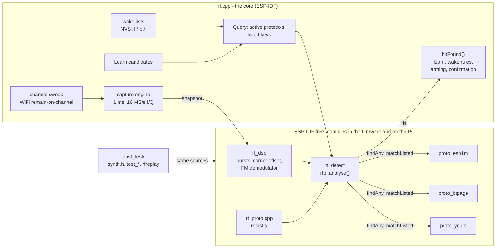

# Adding a wake protocol (2.4G/BT detectors)

The 2.4G/BT wake method recognises a device by a packet it sends when it is
switched on. Each packet format is a **protocol module**: one small `.cpp`
file that knows how to find one kind of packet in demodulated bits. This page
explains how the pieces fit, how to add a module without touching the rest of
the firmware, how to test it on a PC, and how to choose its error budget so
that the console does not wake by itself.

Background: `docs/WAKE_2G4.md` (Nordic Enhanced ShockBurst dongles),
`docs/WAKE_BT_CLASSIC.md` (classic Bluetooth controllers), `docs/SNIFFING.md`
(finding out what a device sends). API and storage: section 23 of
`docs/FINAL_FIRMWARE_SPEC.md`.

## 1. Architecture



| Layer | Files | Knows about |
|---|---|---|
| Core | `src/rf.cpp`, `rf.h` | the radio, WiFi, NVS, the web API, the wake rules. Nothing about packet formats. |
| Signal processing | `src/rf_dsp.{h,cpp}` | snapshots of packed I/Q: burst finder, carrier offset, FM demodulator. No protocols. |
| Detector | `src/rf_detect.cpp`, `rf_proto.h` | the interface below; runs the active protocols over each burst. |
| Registry | `src/rf_proto.cpp` | the list of protocols (one line each). |
| Protocols | `src/proto_*.cpp`, `proto_esb.h`, `btc.h` | one packet format each. |
| Tests | `host_test/` | everything above except the core, on a PC with plain g++/clang. |

A snapshot is processed like this (the same code on the board and on the PC):

1. `findBursts`: envelope over 64 samples, threshold 3x the median, bursts at
   least `minBurst` long (the shortest of the active protocols), at most 8.
2. `burstOffset`: carrier offset from a 250 kHz-step DFT (1 to 7.25 MHz either
   side of the centre).
3. `demodulate`: mix down, filter, FM discriminator, integrate over one bit.
   This is done once per bit rate (1 Mbit/s: 16 samples per bit, 2 Mbit/s: 8),
   so protocols with the same rate must be adjacent in the registry.
4. For each active protocol in registry order: `findAny` (any valid packet:
   Learn, and exact wake), then, if nothing was found, `matchListed` (the
   listed keys with a few wrong bits). The first protocol that finds something
   ends the search in that burst. Each hit goes to the core.

The core turns a hit into a wake like this: a listed key that is armed wakes
the PC on one **exact** hit, or on two **approximate** hits within 5 s.

## 2. The interface (`src/rf_proto.h`)

```cpp
struct Proto {
  const char *id;       // stable, stored in NVS and shown in the API: "esb1m", "btpage"
  const char *name;     // for people
  bool host;            // wake list: false = 2.4G dongle devices ("dongle"), true = Bluetooth hosts ("bt")
  uint8_t keyLen;       // bytes of the key (address, LAP), at most 5
  uint16_t kbps;        // 1000 or 2000
  uint16_t minBurst;    // shortest burst worth analysing, samples at 16 MS/s (16 = 1 us)
  uint16_t minSamples;  // demodulated samples needed
  uint8_t budget;       // wrong bits tolerated in a listed match
  bool (*init)();       // once at start (may allocate); false: protocol stays off. May be null.
  uint64_t (*pattern)(const uint8_t *key);                  // what to look for, for a listed key
  bool (*findAny)(const rfdsp::Burst &b, uint8_t *key, int *wrong);
  int (*matchListed)(const rfdsp::Burst &b, const uint64_t *pats, int n, int budget, int *wrong);
};
```

- **`id`**: at most 7 characters, never changed after release (it is stored in
  the wake list in NVS and appears in the HTTP API as `"proto"`).
- **`host`**: which of the two wake lists the protocol's entries live in. The
  lists, their sizes (8 dongle devices, 2 hosts), the `kind` values and the
  address syntax stay as they are.
- **`findAny`**: scans every sample phase of the burst for a packet that is
  valid by itself (CRC-valid frame, valid access code), whatever its key.
  Learn uses it to discover devices. It returns the key (bytes in the order
  the list stores them, `keyLen` bytes, the rest 0) and `wrong`: 0 means
  error-free, which wakes alone. A protocol with a forward-error-corrected
  code may report 1 (corrected): that counts as approximate.
- **`matchListed`**: the burst's bit stream against the patterns of the listed
  keys (`pattern()` of each), accepting up to `budget` wrong bits. It returns
  the index of the match and its bit errors, or -1. This finds packets that
  fail their CRC because of a bit error somewhere in the payload.
- **Access to bits**: `b.bitT<SPB>(phase, i)` (SPB = 16 or 8, a compile-time
  constant: faster than `b.bit()`); `b.nbits()` bits fit at every phase;
  phases are `0 .. SPB-1`. Always look at all phases: the receiver is not
  synchronised to the bit clock.
- **Rules for these functions**: pure (no I/O, no logging, no ESP-IDF), no
  big stack arrays (the rf task has 6 KB of stack), no allocation (do that in
  `init()`), no static buffers beyond a few hundred bytes, finish in a time
  comparable to `esb1m` (one pass over 16 phases x about 320 bits per call).

The detector's other types are `Hit` (protocol, key, exact, wrong bits,
offset, frequency), `Listed` (pattern + key + protocol index, built by the
core for each wake list entry and, while Learn runs, for each address Learn
has already found) and `Query` (the active protocols and the listed keys).

## 3. Step by step

Worked example: `src/proto_esb2m.cpp`, Nordic ESB at 2 Mbit/s. It is
**experimental** and compiled out by default; it has only been tested with
synthetic signals.

1. **Find out what the device sends** (`docs/SNIFFING.md`): bit rate, packet
   format, what identifies the device (address, access code, ...), whether
   the packet carries a CRC, and the shortest packet.
2. **Pick the list.** A device that has its own address and is heard when it
   is switched on: `host = false` (dongle list). A paging host: `host = true`.
3. **Write `src/proto_<name>.cpp`.** Start from `proto_esb1m.cpp` (three
   lines on top of `proto_esb.h`) or `proto_btpage.cpp` (everything by hand).
   The file ends with the descriptor:

   ```cpp
   extern const rfp::Proto proto_esb2m;   // (const has internal linkage unless declared extern first)
   const rfp::Proto proto_esb2m = {
       "esb2m", "Nordic ESB 2 Mbit/s (experimental)", /*host*/ false, /*keyLen*/ 5, /*kbps*/ 2000,
       /*minBurst*/ 800, /*minSamples*/ 400, /*budget*/ 2,
       /*init*/ nullptr, E5::pattern, E5::findAny, E5::matchListed};
   ```
4. **Register it**: one line in `src/rf_proto.cpp`, in `RF_PROTOCOLS`:
   `X(esb2m)`. Order is detection order; keep protocols of the same bit rate
   together. For an experimental protocol wrap it in a build flag like
   `RF_PROTO_ESB2M` (see the top of `rf_proto.cpp`) and build with
   `PLATFORMIO_BUILD_FLAGS=-DRF_PROTO_ESB2M uvx platformio run`.
5. **Nothing else in the firmware changes.** The core finds the protocol in
   the registry: its entries are stored with the protocol id, Learn runs it,
   the API reports it, the wake rules apply to it.
6. **Test it on the PC** (section 4), including the false-detection test.
7. **Try it on real captures** with `rfreplay` before putting it on a board.
8. **Document it**: a section in `docs/WAKE_2G4.md` (or its own page) with
   the packet format, the budget and its justification, the measurements.
9. A new bit rate needs a demodulator setting: `rfdsp::demodulate` supports 16
   and 8 samples per bit (`Demod<SPB>` in `rf_dsp.cpp`); another value is a
   new instantiation there and in the dispatch of `demodulate()`. This is the
   only DSP change a protocol can need; prove with `host_test` that 1 Mbit/s
   results did not move (the equivalence test does this).

### What the core does for you

| Need | Where |
|---|---|
| Entry stored in NVS with the protocol id | `rf.cpp` `saveList()`: key `proto` next to `n`, `list`, `off` |
| `"proto"` in `GET /api/rf/wake` and `/api/rf/learn` | `rfWakeToJson()`, `rfLearnToJson()` |
| `POST /api/rf/wake/add` with `"proto"` | `rfWakeAdd(addr, mhz, name, err, proto)`; without it the protocol Learn found the address with, else the list's first protocol |
| Learn finds the device | `findAny` hits of every protocol of the list being learnt |
| Wake rules, arming, confirmation | `wakeRules()`: exact wakes, approximate needs two within 5 s |
| Unknown protocol id in NVS (a build without the protocol) | the entry is kept and saved again unchanged, never matched |

## 4. Testing on a PC

`firmware/bc250_controller/host_test/` builds with plain g++ or clang (no
ESP-IDF, no PlatformIO):

```
cd firmware/bc250_controller/host_test
make test              # everything, non-zero exit status on a failure
make test CXX=clang++
```

| Program | What it checks |
|---|---|
| `btc_selftest` | the Bluetooth sync word (GIAC `0x475C58CC73345E72`), BCH check and correction |
| `test_detect` | registry rules; per protocol: frames at carrier offsets of -7 to +7 MHz with noise, listed keys with 0 to 5 wrong bits, bit errors in the payload; equality with the pipeline as it was before the split (`legacy_ref.cpp`) on 300 mixed snapshots, and timing. Built twice: default, and with `-DRF_PROTO_ESB2M` |
| `test_false` | false detections: Monte Carlo against the formulas of section 5, then the whole pipeline over noise, noise bursts, random GFSK, BLE-like packets and other devices' packets with a wake list loaded |
| `rfreplay` | the firmware pipeline over recorded captures (below) |
| `mksigmf` | writes a synthetic SigMF capture; `test_rfreplay.sh` runs both end to end |

### Synthetic signals (`host_test/synth.h`)

```cpp
Bits b = esbRandom(rng, addr, 5, /*payload bytes*/ 12);     // frame with a correct CRC
Bits t = btId(0x9A8B7C);                                     // Bluetooth ID packet of a LAP
flipBits(b, rng, 0, 48, 2);                                  // two wrong bits in preamble + address
auto iq = oneBurst(rng, b, /*samples per bit*/ 16, /*offset Hz*/ 3e6);   // GFSK burst in noise, packed like the capture engine
auto res = pipe.run(iq.data(), listedKeys, activeProtocolMask);          // res.hits, res.bursts
```

Add your protocol's frame builder to `synth.h` (or the test file), then copy
the `testEsb` function of `test_detect.cpp`: exact detection at all offsets,
approximate detection with up to `budget` wrong bits, **no** detection with
`budget + 1` wrong bits. Add the protocol to `test_false.cpp` (its row in
`monteCarlo`). A new protocol must not change what the existing ones report:
the equivalence test in `test_detect.cpp` keeps comparing `esb1m` and
`btpage` with the pre-split pipeline.

### Real captures: `rfreplay`

```
build/rfreplay capture                       # Learn mode: every valid packet is printed
build/rfreplay --key esb1m:A1B2C3D4E5 --key btpage:9A8B7C capture
build/rfreplay --only esb2m --bursts --conj capture
```

It runs `rfdsp` and every protocol, the same sources as the firmware, over a
SigMF recording and prints each hit: snapshot, centre frequency, protocol,
key, exact or approximate, wrong bits, carrier offset. Input:
`<name>.sigmf-meta` (JSON) + `<name>.sigmf-data`, datatype `ci8`, `ci16_le` or
`cf32_le`, `core:sample_rate` exactly 16e6 (otherwise a clear error), one
`captures` entry per snapshot with its own `core:frequency` (Hz) and
`core:sample_start`. A capture is analysed in the 16380-sample units the
firmware uses. Scaling: `ci8` x4, `ci16_le` as 10-bit counts, `cf32_le` x511
(`--gain` changes it); if a recording shows bursts and no hits try `--conj`
(mirrored spectrum). The Python tools in `tools/sniffer/` write this format
from esp-sdr captures (`docs/SNIFFING.md`). The controller itself will later
be able to export snapshots in the same format.

Use it to: confirm that a real device is found, count how many of its packets
are CRC-valid and how many only match by address, see the bit errors of the
approximate hits (this gives the error budget, below), and look for hits on
captures of other traffic (false detections).

## 5. Error budgets and confirmation: how not to wake the console by accident

A listed match accepts a pattern of `n` bits with up to `e` wrong bits. For
random data the probability that one window matches is

    p(n, e) = sum_{k=0..e} C(n, k) / 2^n

| Detector | n | e | p per window |
|---|---|---|---|
| `esb1m` listed (preamble + 5-byte address) | 48 | 2 | 4.2e-12 |
| `esb1m` listed | 48 | 3 | 6.6e-11 (16 times more) |
| `btpage` listed (sync word) | 64 | 3 | 2.4e-15 |
| `btpage` exact (the listed sync word, or one corrected bit) | 64 | 1 | 63 x 2^-64 = 3.4e-18 |
| `btpage` any LAP (Learn) | 64 | 1 corrected | 63 x 2^24 / 2^64 = 5.7e-11 |
| `esb1m` any CRC-valid frame (Learn) | per position | | about 6e-8 x (fraction that fits) |

The detector looks at **all 16 sample phases** of a burst and every bit
position, up to 8 bursts per snapshot, and `esb1m` takes about 23 snapshots a
second. For the worst case (the bursts are all long and look like random
data, e.g. a busy neighbour's WiFi):

    windows per snapshot   W = 8 bursts x 16 phases x 276 positions = 35,000
    windows per second     23 x W = 8.1e5
    windows per year       2.6e13

Expected false matches of **one listed key**:

| | esb1m (e = 2) | btpage (e = 3) |
|---|---|---|
| per window | 4.2e-12 | 2.4e-15 |
| per year, one match is enough | 2.6e13 x 4.2e-12 = **110** | 2.5e13 x 2.4e-15 = **0.06** |
| two matches within 5 s (the rule) | 110 x (4.1e6 x 4.2e-12 = 1.7e-5) = **0.002** | 0.06 x (3.8e6 x 2.4e-15 = 9e-9) = **5e-10** |

This is why an approximate match alone never wakes the PC: without the second
match the `esb1m` budget of 2 would give a false wake every few days in the
worst case, with it about once in 500 years (and only while the entry is
armed and the PC is off). A budget of 3 would be 16 times likelier per match
and 250 times for the pair (one false wake in about 2 years in the worst
case) for a few extra catches: of 58 catches of a searching keyboard, 19 were
address matches (wrong bits 0: 12, 1: 2, 2: 3, 3: 2), so budget 3 would add
about 3 %.

An **exact** hit wakes alone, so it must be practically impossible by chance:
for `esb1m` a random burst has to contain a CRC-valid frame (about 6e-5 per
burst of random data, measured and computed) *with the listed address*
(2^-40): about 3e-7 per year. For
`btpage` it is 3.4e-18 per window, about 1e-4 per year.

How to choose for a new protocol:

1. Count the bits `n` of the pattern. If `n` is small (under about 40), a
   budget of 0 or 1 is all you can afford, and more of the packet (a CRC)
   must take part in the decision.
2. Choose `e` so that the "two matches within 5 s" figure is below 1e-3 per
   year in the worst case above. The formula is in `test_false.cpp` (`tail`).
3. If the protocol has a CRC, make a CRC-valid frame the **exact** path. Pure
   pattern matches are always approximate, even with 0 wrong bits.
4. If the protocol has no check at all, only the pattern can be used:
   require two matches (approximate), and consider a longer pattern (include
   more of the header).
5. Measure with `rfreplay` on real captures: the distribution of wrong bits of
   true packets tells how many catches a budget gives (above), captures of
   other traffic show the false matches. `test_false` verifies the formula
   itself with a relaxed budget (it agrees within a few percent, e.g. 1320
   measured against 1322 expected for `esb1m` with e = 9) and reports zero
   matches at the real budgets.

The windows of one burst are not independent (neighbouring positions share
bits), which makes the expected counts above slightly pessimistic for the
"at least one" case, not optimistic.

## 6. Constraints of the ESP32-C3 and rules

- **CPU**: one RISC-V core at 160 MHz shared with WiFi. On the PC a snapshot
  with three bursts takes about 0.17 ms; the board is much slower (not
  measured yet; use the `MEMCHECK` build, `docs/ESP_IDF_BUILD.md`). Each
  extra protocol adds a pass per burst: keep to one linear scan over the
  burst's bits; no per-sample floating point in the hot path. The host test
  prints the time per snapshot against the pre-split pipeline; a new module
  must not slow the existing ones down (they are compared on the same
  corpus).
- **Memory**: the rf task has a 6 KB stack (heap, never quiet memory). The
  working buffers (about 25 KB: demodulated samples, envelope, sine table) are
  allocated by the core in "quiet memory", the lower 64 KiB of the capture
  bank: only the CPU touches it, never during a capture. Static RAM must stay
  below the capture bank (`tools/ram_guard.py` fails the build otherwise).
  Do not add static tables larger than a few hundred bytes; allocate in
  `init()` from the heap (the Bluetooth module's 2 KiB syndrome tables are
  the example).
- **Nothing during a capture**: during the ~1 ms capture the engine owns the
  bank and the CPU is in a critical section. Protocol code only runs after.
- **Never tune or calibrate the radio.** The WiFi driver tunes the receiver for
  each channel visit; the capture only reads what is there. A wake feature
  must not change the channel, gain, filters or any RF register.
- **Never block WiFi.** The sweep stands aside when WiFi scans, roams,
  connects or an update runs (`wifiRadioBusy()`, `webOtaRunning()`), visits
  last about 6 ms with 25 ms of WiFi's time between them. Protocol code adds
  CPU time inside that gap: keep it short.
- **Window size**: the demodulated burst is limited to 5200 samples. At
  1 Mbit/s a frame is decoded completely up to about 25 bytes of payload;
  longer frames are found by address only (approximate). A bare ESB frame
  without payload is 73 us and often below the 75 us minimum burst of
  `esb1m`.
- **Both polarities**: `esb1m` and `btpage` search only the normal polarity
  (inverted never showed up). If your device is inverted, check the spectrum
  with `rfreplay --conj`.
- Keep the key unique: an entry is identified by its list and key; the same
  key under two protocols is one entry.

## 7. Storage and API (backward compatible)

- Wake lists: NVS namespaces `rf` (2.4G dongle devices, up to 8) and `bth`
  (Bluetooth hosts, up to 2). The records (`list`), count (`n`) and disabled
  mask (`off`) are unchanged. The new string key `proto` holds the protocol
  ids of the entries, comma separated, in the order of the records
  (`"esb1m,esb2m"`). Absent or empty: every entry has the list's first
  protocol, as stored by firmware that does not know the key. Firmware that
  does not know the key ignores it.
- `GET /api/rf/wake`: items have `"proto"` next to `kind`. `GET /api/rf/learn`:
  `found` items have `"proto"`. Existing fields and `kind` values do not change.
- `POST /api/rf/wake/add`: optional `"proto"` (`rfWakeAdd(..., proto)`). An
  unknown id is refused ("unknown protocol"); an id that belongs to the other
  list is refused ("address does not fit that protocol"). Without it, the
  entry gets the protocol Learn found that address with.
- The web UI can show a protocol tag from these fields and pass `proto` back
  when adding a learnt device; an UI that ignores them keeps working.
