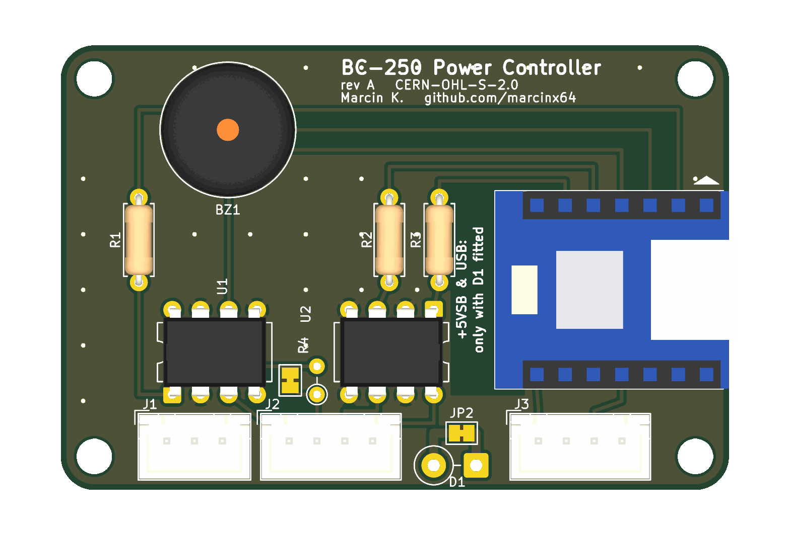
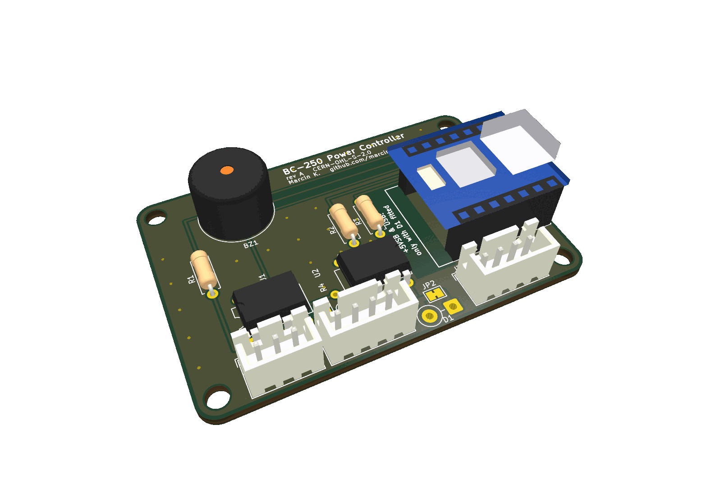
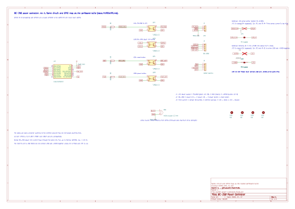

# Hardware: PCB rev A

**Status: the rev A PCB has NOT been fabricated or tested yet.** It is a
2-layer layout of the same circuit and GPIO map as the perfboard build. The
perfboard build ([`../docs/HARDWARE.md`](../docs/HARDWARE.md)) is the tested
reference. Expect to find mistakes in rev A; please report them.

Licence: CERN-OHL-S-2.0. Author: Marcin K., github.com/marcinx64.

## What is here

| Path | Content |
|---|---|
| `kicad/bc250-power-controller.kicad_{pro,sch,pcb}` | KiCad 10 project (source of truth) |
| `kicad/bc250.kicad_sym`, `kicad/bc250.pretty`, `kicad/3d` | Project symbols (XIAO, TLP521-2), XIAO footprint and a simple 3D model |
| `kicad/scripts/` | Python generators and `export.sh`, so the design is reproducible |
| `schematic.pdf`, `schematic.svg` | Schematic |
| `renders/` | PCB top, bottom and 3D renders |
| `fab/bc250-power-controller-gerbers.zip` | Gerbers and Excellon drill files (PTH and NPTH) |
| `bom.csv` | Bill of materials with example part numbers |
| `wiring.svg` | Wiring to the ATX plug, the BC-250 and the front switch |
| `hardware.json` | Machine-readable pin map and netlist notes |

## Board

60 x 40 mm, 2 layers, rounded corners, four M3 holes. All parts are
through-hole. The XIAO ESP32-C3 sits on two 1x7 2.54 mm sockets (rows 15.24 mm
apart) with its USB-C connector at the right board edge. A copper keep-out
(no tracks, pour or vias) lies under the XIAO's antenna end; tracks pass above
the module's long side at least 1.3 mm from it. GND is poured on both layers
with stitching vias. Tracks are 0.3 mm for signals and 0.8 mm for +5V and
+5VSB.

Connectors are JST XH (2.5 mm): common, polarised, cheap and easy to crimp.
Screw terminals would need more board area.

| Connector | Pins |
|---|---|
| J1 ATX | 1 PS_ON# (green, ATX pin 16), 2 GND (black, pin 15), 3 +5VSB (purple, pin 9) |
| J2 BC-250 | 1 power LED +, 2 power LED -, 3 power button live pad, 4 reset button live pad |
| J3 front switch | 1 contact NO (white), 2 common (yellow, GND), 3 LED + (red), 4 LED - (black, GND) |

The switch's green NC wire is not used. See [`wiring.svg`](wiring.svg).

## The circuit in short

- **PS_ON# (U1A):** GPIO3 drives an opto LED through R1 (220 R). The opto
  transistor pulls ATX PS_ON# to GND, which turns the supply on.
- **Power and reset buttons (U2):** GPIO6 and GPIO7 drive the LEDs through R2
  and R3. Each opto transistor pulls the button's live pad to GND, like a
  press. Nothing is back-fed into the BC-250.
- **Power LED sense (U1B):** the BC-250 power LED current flows through the
  opto LED, and its transistor pulls GPIO5 (internal pull-up) low while the
  LED is lit.
- **Buzzer:** active buzzer on GPIO4, driven directly (firmware sets maximum
  drive strength).
- **Front switch:** contact on GPIO20 (pull-up, active low), LED on GPIO10 (PWM).
- **Power:** +5VSB from the ATX supply feeds the XIAO 5V pin (= USB VBUS).
  All grounds are common, so the optos switch but do not isolate.
- GPIO2, 8, 9 (strapping) and GPIO21 are unused. The pin map is unchanged
  from the firmware (`firmware/bc250_controller/src/pins.h`).

### Optional parts that fix known issues

| Part | Purpose | As shipped |
|---|---|---|
| R4 (470 R) with jumper JP1 | Limits the LED-sense opto current if the BC-250 LED pads supply more than about 20 mA | JP1 closed, R4 not fitted |
| D1 (1N5819) with jumper JP2 | Schottky diode in the +5VSB line so USB and +5VSB can be connected together | JP2 closed, D1 not fitted |

To use one: fit the part, then cut the thin copper bridge of its jumper on
the top side. The diode costs about 0.3 V, so the XIAO runs from about 4.7 V
instead of 5 V, which is fine for its 3.3 V regulator. **Without D1 fitted
(and JP2 cut), never connect USB and +5VSB at the same time.**

## Bill of materials

| Ref | Qty | Part |
|---|---|---|
| U3 | 1 | Seeed XIAO ESP32-C3, plus 2 x 1x7 female 2.54 mm header (8.5 mm) |
| U1, U2 | 2 | TLP521-2, DIP-8 (LTV-827, PC827, EL827 are pin-compatible); sockets optional |
| R1, R2, R3 | 3 | 220 R 1/4 W axial |
| R4 | 1 | 470 R, optional |
| D1 | 1 | 1N5819, optional |
| BZ1 | 1 | 12 mm active buzzer, 5 V, 7.6 mm pin spacing |
| J1 | 1 | JST B3B-XH-A (+ XHP-3 housing) |
| J2, J3 | 2 | JST B4B-XH-A (+ XHP-4 housings) |
| MH1-4 | 4 | M3 screws and standoffs |

Full list with example part numbers: [`bom.csv`](bom.csv). Part numbers and
distributor SKUs there are suggestions; check them before ordering. The 12 mm
buzzer footprint (12 x 9.5 mm, 7.6 mm pitch) and the XIAO footprint's
dimensions were not checked against physical parts.

## Ordering the PCB

1. Upload `fab/bc250-power-controller-gerbers.zip` to JLCPCB, PCBWay or
   similar. Settings: 2 layers, 60 x 40 mm, 1.6 mm, any solder mask colour,
   HASL or ENIG.
2. Through-hole parts only: no assembly service or stencil is needed.
3. Check the preview: the drill files are `-PTH.drl` and `-NPTH.drl`.
4. The pin-name silkscreen is small (0.55 mm text). Most fabs print it, but a
   larger font may be wanted.

## Assembly and checks

1. Solder low parts first: resistors, then DIP sockets or optos (pin 1 dot
   towards the square pad), the JST headers, the buzzer (+ on the square
   pad), then the XIAO sockets. Fit R4 or D1 only if needed (see above).
2. Do not fit the XIAO yet. With a multimeter in continuity mode check:
   no short between GND and the 3V3 socket pin, and none between GND and the
   5V socket pin.
3. Check continuity from each connector pin to its XIAO socket pin or opto
   pin as in the netlist (`bom` and `schematic.pdf`).
4. Insert the XIAO and U1, U2.
5. **First power-up on USB with nothing else connected** (no ATX, no
   BC-250, no front switch). The board should boot and open its Wi-Fi access
   point as usual; the buzzer beeps.
6. Connect the front switch, then the BC-250 wires, then the ATX supply last
   (without USB).

## Safety rules

- Never connect USB and ATX +5VSB at the same time unless D1 is fitted and
  JP2 is cut.
- The ATX supply must have +5VSB.
- Only the live pad of each BC-250 button is wired; the optos switch it to GND.
- Never start UART0 in firmware: its RX is GPIO20 (front switch).
- Do not use GPIO2, 8, 9 or 21 for anything else.

## Verification status

- ERC: 0 errors, 0 warnings. DRC: 0 violations, 0 unconnected items, schematic
  parity clean. Both with KiCad 10.0.8.
- Not verified: footprint dimensions of the XIAO headers/USB end and the
  buzzer; the 3D XIAO model is a simple stand-in.
- Not tested on real hardware.

## Rebuilding

From the repository root, with KiCad 10 installed as a flatpak: run the
scripts in `kicad/scripts/` (`gen_libs.py`, `gen_sch.py`, then export the
netlist and run `gen_pcb.py`, then `export.sh`). The KiCad files themselves
are the source of truth; edit them in KiCad if you prefer.
